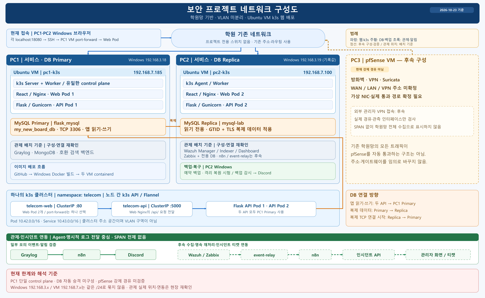
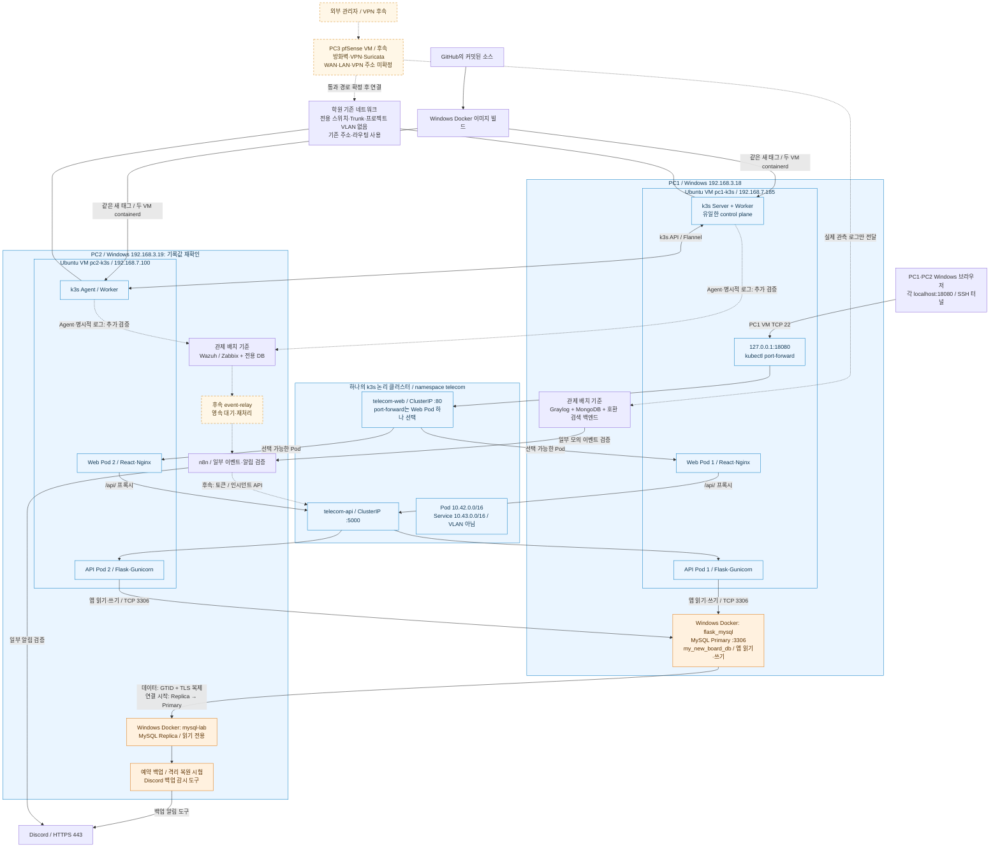

# 학원망 기반 보안 프로젝트 네트워크 구성도

2026-10-23 기준 / 프로젝트 전용 스위치 없음 / VLAN 미분리.

[PNG 다운로드](academy-k3s-20261023.png) · [편집 가능한 SVG](academy-k3s-20261023.svg)

최종 그림은 한글·배치·연결 방향을 고정한 SVG와 그 원본에서 렌더링한 3000×1850 PNG다. 아래 Mermaid와 [주소](../address-plan.md)·[포트](../port-matrix.md)를 함께 확인한다. 점선은 후속 연결/검증이다. 관제의 물리 PC별 위치는 배치 기준이며 전체 연동 완료를 뜻하지 않는다.

## 수정 가능한 Mermaid 원본

## 읽는 기준과 한계

1. 두 PC 모두 웹/API를 실행한다. PC2를 Web Standby로 표시하지 않는다. DB만 Primary/Replica다.
2. DB·관제는 Windows Docker 또는 별도 자원에 두고 Ubuntu 웹 VM 내부 Pod로 그리지 않는다.
3. port-forward는 Web Pod 하나를 선택한다. Web 2개·API Service가 있어도 이 임시 진입점의 외부 자동 분산/자동 전환을 입증하지 않는다.
4. 앱 읽기·쓰기는 PC1 Primary다. 복제 데이터는 PC1 → PC2, TCP 연결 시작은 PC2 → PC1이다. 승격은 수동 후속 작업과 백업 도구 보완이 필요하다.
5. PC3 pfSense/VPN/Suricata는 후속이다. 모든 학원망 통신이 통과하거나 SPAN 없이 전체 트래픽이 관측된다고 표시하지 않는다.
6. PC1 단일 control plane, PC2 로컬 백업, 외부 HTTPS/상시 진입점 미확정이 남은 한계다. 이 문서 변경은 현장 장비 설정 변경이 아니다.

[저장소 분석 및 검증 범위](../../docs/architecture/academy-network-20261023.md) · [통신 경로](../../docs/contracts/traffic-flow.md)
